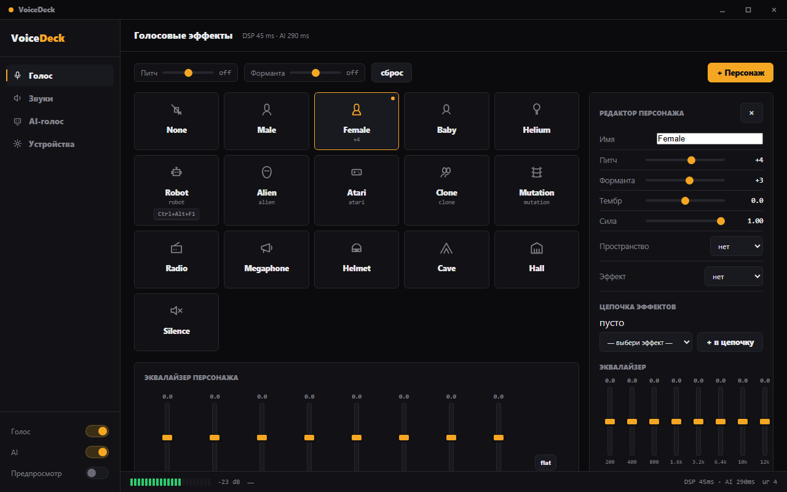
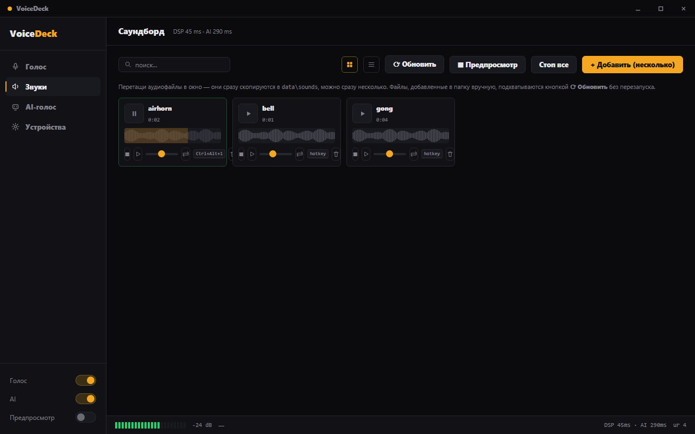
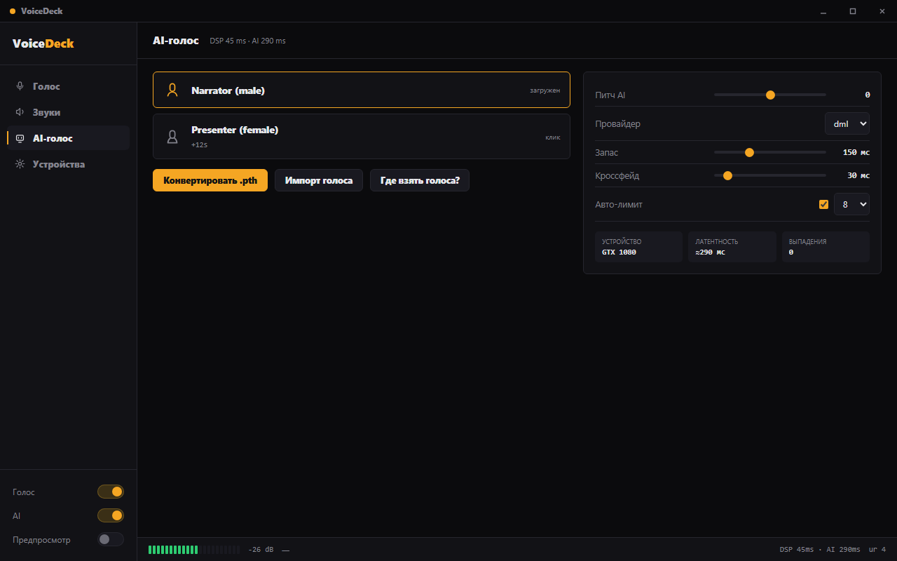
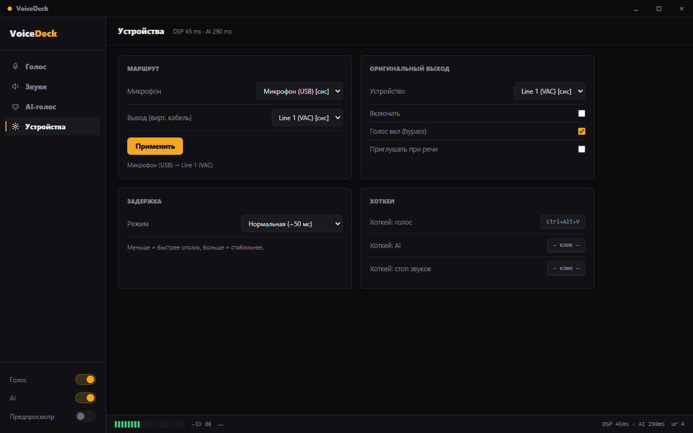

# VoiceDeck

**Soundpad + Voicemod in one app.** A hotkey soundboard, DSP voice changer and live AI voice conversion (RVC) written in C++20 for Windows. All data lives in `data\` next to the executable — fully portable, nothing is written to system folders.

[Русская версия](README.md)



## Features

- **Soundboard** — card/list views, waveform with seeking, volume, loop, removable hotkeys, speaker preview and a separate “Hear sounds” toggle for monitoring the main soundboard. Drag & drop adds a whole batch at once and copies files into `data\sounds`.
- **Tags & search** — custom tags per clip, search by name or tag, tag filter chips. The built-in `hotkey` tag is added when a shortcut is assigned and removed automatically when it is cleared.
- **Audio editor** — trim, global gain, per-region gain, equal-power fade-in/fade-out and a live spectrogram that follows edits. Edits are non-destructive: the source file stays untouched, parameters live in `sounds.json`.
- **Application capture** — mix audio from up to 8 processes into the virtual cable alongside your voice and soundboard. The list combines active audio sessions and windows, with search by name, window title or PID; each capture has its own volume and status. Requires Windows 10 build 20348+ or Windows 11; protected or elevated apps may require running VoiceDeck as administrator.
- **Windows startup** — launch with Windows, an "always run as administrator" mode (UAC relaunch) and a startup console-hiding option. CLI mode (`--cli`) always shows its output.
- **Low latency & idle** — 256/480/960 buffer modes, an adaptive jitter buffer for virtual-cable clock drift, VAD sleep for the voice branch (the soundboard keeps playing) with AI pre-roll, and a zero-latency soft clipper. The silence threshold is adjustable on the Voice tab.
- **45 voice characters** — pitch, formant, timbre and 8-band EQ. Legacy chains such as `radio → robot → cave` remain supported.
- **VoiceLab** — a visual chain builder with 18 modules: Pitch, Formant, Vocoder, Bitcrusher, Ring Modulator, Distortion, Chorus, Reverb, Delay, 8-band EQ, Tremolo, Flanger, Phaser, Wah Wah, Stutter, Stereo Width, Compressor and Octaver. Add, remove and drag modules; every module has independent Strength/Mix, frequency, drive, depth, decay, feedback and its own 8-band EQ. Edits to built-in characters revert when you leave the editor; "Save as New" persists them in a new character.
- **Background ambiences** — VAD-gated radio static with an end-of-phrase chirp, cockpit hum and cave wind. Toggle them globally, assign one to any character, or import a custom seamless loop.
- **Soundboard FX Send** — route songs and memes through the current voice preset and loaded RVC voice. Mic and soundboard use independent DSP/AI paths; simultaneous RVC work always prioritizes the live microphone.
- **AI voice** — RVC v2 via ONNX Runtime (DirectML / CUDA / CPU), ~45–290 ms depending on model and GPU. Built-in `.pth` converter right from the UI.
- **RU/EN localization** — language selector on the Devices tab; the choice is saved in `data\settings.json`.
- **Devices** — mic and virtual cable selection, monitoring, latency mode, global hotkeys.
- **No allocations or locks in the audio callback** — lock-free SPSC rings and atomics.



## Quick start

```powershell
git clone https://github.com/ZekiTRR/VoiceDeck.git
cd VoiceDeck
cmake -S . -B build
cmake --build build --config Release
build\Release\voicedeck.exe
```

Or run `voicedeck.exe --cli` for the headless console mode with the same feature set.

**First launch:** open the *Devices* tab, pick your microphone and virtual cable (VB-CABLE / VAC). Enable *Preview* if you want to hear yourself.

> In Discord/games, select the **virtual cable output** (`CABLE Output` / `Microphone (Line 2)`) as the microphone — otherwise apps will hear your clean voice.

## `data\` layout

```
data\
  settings.json     devices, latency, AI tuning, hotkeys
  sounds.json       sound library: tags, hotkeys and audio-editor settings (trimStart/trimEnd/gain/regions)
  characters.json   voice characters, VoiceLab chains and ambiences
  sounds\           clips (added files are copied here)
  AiVoice\          content_encoder.onnx, rmvpe.onnx, voices\*.onnx + *.json
  ambiences\        custom background loops (up to 120 seconds)
```

## AI voice



A voice is a `name.onnx` + `name.json` pair (Voice CTX format 1) in `data\AiVoice\voices\`.

- **"Where to get voices?"** opens the official Voice CTX model pack (base models + two English VCTK voices).
- **"Import voice"** adds an existing `.onnx` + `.json` pair.
- **"Convert .pth"** converts an RVC v2 checkpoint inside the app. Checkpoints are loaded with `torch.load(weights_only=True)` — no code from the file is executed. The first run creates an isolated Python environment in `data\aivoice\venv` (Python 3.10–3.12 and internet required).
- **Format 2** — new conversions use the low-latency 50 ms block / 400 ms context / 10 ms crossfade layout (`format: 2`, ~80 ms AI with a 20 ms margin). Existing v1 models (100/600/40) keep working without re-conversion.
- **FP16 (optional)** — a checkbox during conversion produces a roughly half-size GPU model. If FP16 conversion or loading fails, the converter/app stay on FP32.

For Russian or other languages you need a voice trained on that language — VCTK is English only.

## Devices



WASAPI devices on Windows 10/11. Setting 48 kHz on your mic and cable is recommended.

## Building

Requires Windows 10/11 x64, MSVC (C++20), CMake 3.20+. WebView2 Runtime ships with Windows 10/11. All dependencies (miniaudio, nlohmann/json, Signalsmith, DaisySP, iir1, ONNX Runtime, WebView2 SDK) are vendored in `third_party\`.

## License and credits

MIT. Built on RVC, HuBERT, RMVPE, ONNX Runtime, miniaudio, Signalsmith and DaisySP. Built-in VCTK voices: CC BY 4.0 (data) / Apache-2.0 (models). Only use AI voices you have the rights to.
