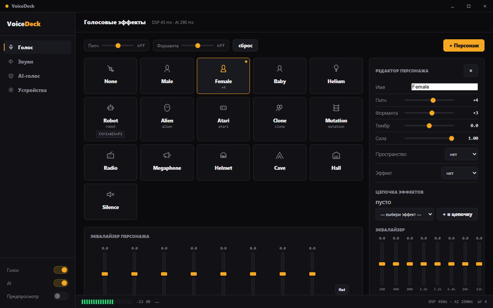
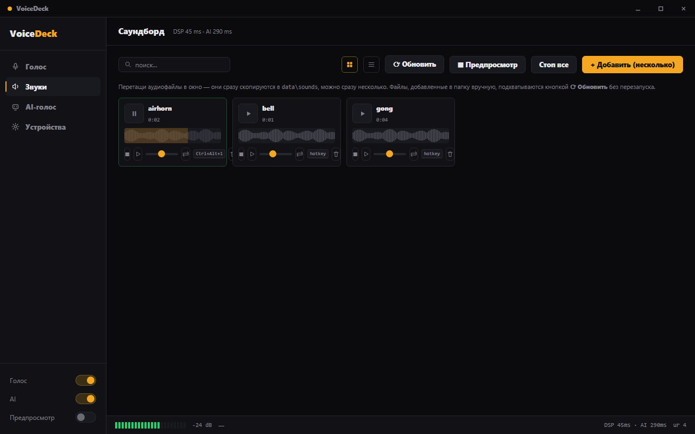
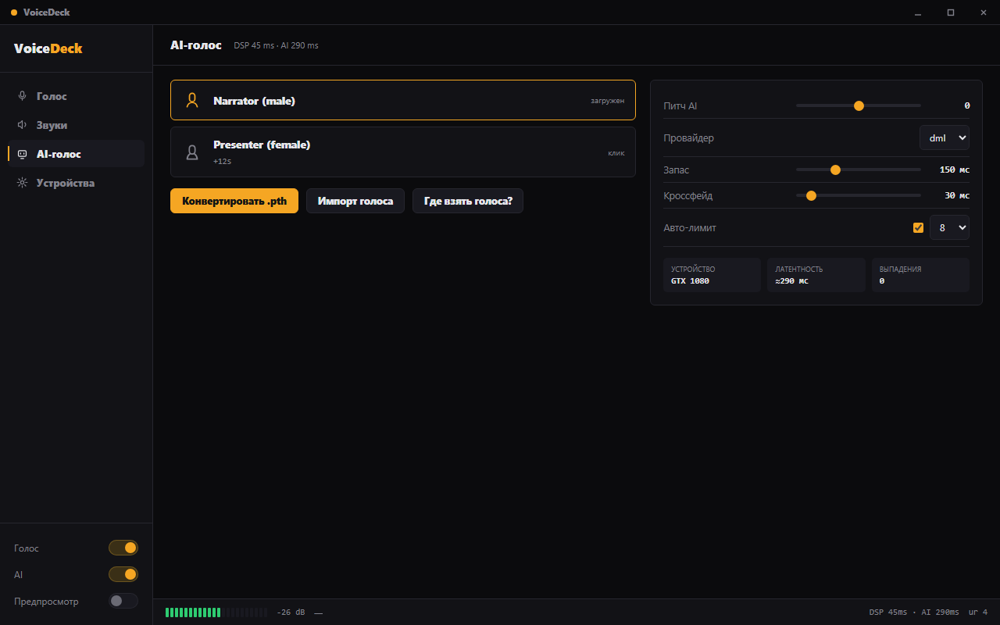
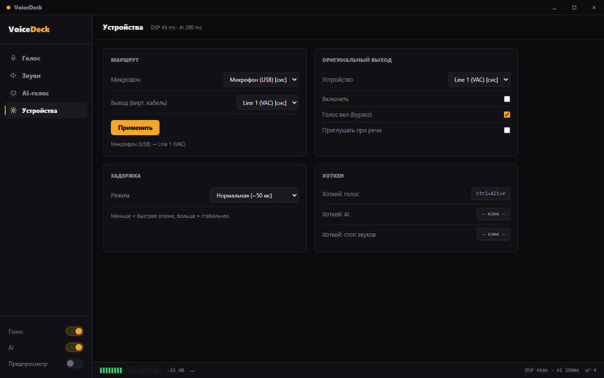

# VoiceDeck

**Soundpad + Voicemod в одном приложении.** Саундборд с горячими клавишами, DSP-преобразование голоса и живой AI-голос (RVC) на C++20 для Windows. Всё данные лежат рядом с `.exe` в папке `data\` — портативно, без записи в системные папки.

[English version](README.en.md)



## Возможности

- **Саундборд** — карточки/список, waveform с перемоткой, громкость, луп, hotkey, предпрослушивание на динамики. Перетаскивание файлов в окно добавляет сразу пачку и копирует звуки в `data\sounds`.
- **Теги и поиск** — свои теги у звуков, поиск по имени и тегам, фильтр по тегам. Встроенный тег `hotkey` ставится автоматически, когда звуку назначена горячая клавиша.
- **Редактор звука** — быстрая обрезка, общая громкость и отдельные участки со своей громкостью прямо в приложении. Правки неразрушающие: оригинальный файл не меняется, параметры хранятся в `sounds.json`.
- **Запуск Windows** — автозапуск вместе с Windows и режим «всегда от имени администратора» (перезапуск через UAC).
- **Низкая задержка и простой** — режимы буфера 256/480/960, адаптивный jitter-буфер с компенсацией дрейфа виртуального кабеля, VAD-сон голосовой ветки (звуки продолжают играть) с pre-roll для AI и zero-latency soft clipper. Порог тишины настраивается во вкладке «Голос».
- **45 голосовых персонажей** — питч, форманта, тембр, 8-полосный EQ, цепочка эффектов (radio → robot → cave), живое применение изменений («Save as New» создаёт отдельного персонажа).
- **AI-голос** — RVC v2 через ONNX Runtime (DirectML / CUDA / CPU), задержка ~45–290 мс в зависимости от модели и GPU. Встроенный конвертер `.pth` → модель VoiceDeck прямо из UI.
- **Устройства** — выбор микрофона и виртуального кабеля, мониторинг, задержка, хоткеи.
- **Горячие клавиши и трей**, без аллокаций и блокировок в аудиокалбэке (lock-free SPSC-кольца).



## Быстрый старт

```powershell
git clone https://github.com/ZekiTRR/VoiceDeck.git
cd VoiceDeck
cmake -S . -B build
cmake --build build --config Release
build\Release\voicedeck.exe
```

Альтернатива: `voicedeck.exe --cli` — головной консольный режим с теми же возможностями. Команды для новых функций: `tags [тег]`, `tag <id> <тег...>`, `tagadd/tagrm <id> <тег>`, `edit <id> {'trimStart':1,'trimEnd':5,'gain':1.5,'regions':[{'start':0,'end':1,'gain':0.5}]}`, `autostart on|off`, `admin on|off`, `vad <-60..-20>`.

**Первый запуск:** открой вкладку «Устройства», выбери микрофон и виртуальный кабель (VB-CABLE / VAC), при необходимости включи «Предпросмотр» чтобы слышать себя.

> В Discord/играх микрофоном должен быть **выход виртуального кабеля** (`CABLE Output` / `Microphone (Line 2)`), а не физический микрофон — иначе приложения услышат чистый голос.

## Структура `data\`

```
data\
  settings.json     устройства, режим задержки, настройки AI, хоткеи
  sounds.json       библиотека звуков: теги, хоткеи и параметры редактора (trimStart/trimEnd/gain/regions)
  characters.json   голосовые персонажи
  sounds\           клипы (все добавленные файлы копируются сюда)
  AiVoice\          content_encoder.onnx, rmvpe.onnx, voices\*.onnx + *.json
```

## AI-голос



Модель — пара `name.onnx` + `name.json` (Voice CTX format 1) в `data\AiVoice\voices\`.

- **«Где взять голоса?»** — официальный пак моделей Voice CTX (базовые модели + два английских голоса VCTK).
- **«Импорт голоса»** — готовую пару `.onnx` + `.json`.
- **«Конвертировать .pth»** — конвертация RVC v2 чекпоинта прямо в приложении. Чекпоинт читается через `torch.load(weights_only=True)`, код из файла не исполняется. При первом использовании создаётся изолированное Python-окружение в `data\aivoice\venv` (нужны Python 3.10–3.12 и интернет).

Для русского и других языков нужен голос, обученный на этом языке — VCTK только английский.

## Устройства



Поддерживаются WASAPI-устройства Windows. Рекомендуется заранее выставить 48 kHz в свойствах микрофона и кабеля.

## Сборка

Требуются: Windows 10/11 x64, MSVC (C++20), CMake 3.20+. WebView2 Runtime встроен в Windows 10/11. Зависимости (miniaudio, nlohmann/json, Signalsmith, DaisySP, iir1, ONNX Runtime, WebView2 SDK) включены в `third_party\`.

## Лицензия и благодарности

MIT. Использует наработки RVC, HuBERT, RMVPE, ONNX Runtime, miniaudio, Signalsmith, DaisySP. Встроенные голосовые модели VCTK: CC BY 4.0 (данные) / Apache-2.0 (модели). Используйте AI-голоса только там, где у вас есть на это права.
